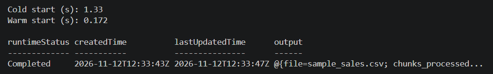

# Assignment 2 — Event-Driven Processing with Azure Durable Functions

An event-driven serverless pipeline built on **Azure Functions (Flex Consumption, Python 3.12)** and **Azure Durable Functions** using the **Fan-Out / Fan-In** pattern. When a CSV file arrives in Azure Blob Storage, an **Event Grid** subscription triggers an orchestrator that splits the records into parallel chunks, processes them concurrently across activity functions, aggregates the totals, and writes a JSON summary back to Blob Storage.

---

## Dataset
* **Source**: Synthetic dataset generated locally via `generate_data.py` (`sample_sales.csv`).
* **Size**: **1,500 records** (exceeding the 1,000-row minimum), split into **6 chunks of 250 records** during orchestration.
* **Schema**: `transaction_id`, `category`, `amount`.

---

## How to Run Locally

1. **Prerequisites**:
   * Python 3.12+
   * Azure Functions Core Tools v4 (`func --version` prints `4.x`)
   * Azurite local storage emulator (VS Code extension or CLI)

2. **Install dependencies**:
   ```powershell
   python -m venv .venv
   .\.venv\Scripts\Activate.ps1
   pip install -r requirements.txt
   ```

3. **Generate the sample CSV**:
   ```powershell
   python generate_data.py
   ```

4. **Configure local settings** (create `local.settings.json` locally — excluded from Git via `.gitignore`):
   ```json
   {
     "IsEncrypted": false,
     "Values": {
       "AzureWebJobsStorage": "UseDevelopmentStorage=true",
       "FUNCTIONS_WORKER_RUNTIME": "python"
     }
   }
   ```

5. **Start Azurite and the Functions host**:
   * Start Azurite in VS Code (`Ctrl + Shift + P` → `Azurite: Start`).
   * Run the Functions host:
     ```powershell
     func start
     ```

6. **Trigger the orchestration locally** (Event Grid cannot reach `localhost`, so an HTTP starter endpoint `start-local` triggers the same orchestrator):
   ```powershell
   $start = Invoke-RestMethod "http://localhost:7071/api/start-local"
   Start-Sleep -Seconds 5
   Invoke-RestMethod $start.statusQueryGetUri | Select-Object runtimeStatus, output
   ```

---

## How It Was Deployed to Azure

1. **Create Resource Group, Storage Account, and Containers** (in `swedencentral`):
   ```powershell
   $RG = "rg-cloud-assignment2"
   $REGION = "swedencentral"
   $ST = "stassign2kat123"
   $APP = "func-assign2-kat123"

   az group create -n $RG -l $REGION
   az storage account create -n $ST -g $RG -l $REGION --sku Standard_LRS
   $CONN = $(az storage account show-connection-string -g $RG -n $ST --query connectionString -o tsv)
   az storage container create --name uploads --connection-string $CONN
   az storage container create --name summaries --connection-string $CONN
   ```

2. **Create the Flex Consumption Function App (2,048 MB instance memory, Python 3.12)**:
   ```powershell
   az provider register --namespace Microsoft.Web --wait
   az provider register --namespace Microsoft.EventGrid --wait

   az functionapp create -g $RG -n $APP --storage-account $ST `
     --flexconsumption-location $REGION --runtime python --runtime-version 3.12 `
     --instance-memory 2048
   ```

3. **Publish the Function App**:
   ```powershell
   func azure functionapp publish $APP
   ```

4. **Create the Event Grid Subscription** (subscribing the Event Grid blob trigger to `Microsoft.Storage.BlobCreated` events on the `uploads` container):
   ```powershell
   $KEY = (az functionapp keys list -g $RG -n $APP --query "systemKeys.blobs_extension" -o tsv --only-show-errors)
   $STORAGE_ID = (az storage account show -g $RG -n $ST --query id -o tsv --only-show-errors)
   $ENDPOINT = "`"https://$APP.azurewebsites.net/runtime/webhooks/blobs?functionName=Host.Functions.blob_starter&code=$KEY`""

   az eventgrid event-subscription create `
     --name uploads-sub `
     --source-resource-id $STORAGE_ID `
     --endpoint $ENDPOINT `
     --included-event-types Microsoft.Storage.BlobCreated `
     --subject-begins-with /blobServices/default/containers/uploads/
   ```

5. **Clean Up**: Deleted `$RG` (`az group delete -n $RG --yes --no-wait`) immediately after capturing evidence.

---

## Evidence of Execution

### 1. Resulting Summary Output (`evidence_summary.json`)
Uploaded `sample_sales.csv` to the `uploads` container; Event Grid triggered `blob_starter`, fanned out 6 `process_chunk` activities in parallel, and wrote `sample_sales_summary.json` to `summaries`:

```json
{
  "file": "uploads/sample_sales.csv",
  "chunks_processed": 6,
  "total_records": 1500,
  "total_revenue": 381441.59,
  "average_transaction": 254.29
}
```

### 2. Orchestration Completion & Latency Screenshot


* **Orchestration Status**: `Completed` (`2026-11-12T12:33:43Z` to `2026-11-12T12:33:47Z`)

---

## Part C — Cost, Cold Start, Breaking Point, and AWS Equivalent

### 1. Monthly Cost Analysis
* **Pricing Source & Date**: Published Azure Functions Flex Consumption On-Demand USD list pricing and free grant limits, retrieved **14 October 2026** (Session 7 Reference Appendix & Microsoft Azure Pricing).
  * **Compute (On-Demand)**: `$0.000026` per GB-second (free monthly grant: **100,000 GB-seconds**).
  * **Executions**: `$0.40` per million executions (free monthly grant: **250,000 executions**).
  * **Storage (Standard LRS Hot)**: `$0.0184` per GB/month; Event Grid operations: `$0.60` per million operations (first 100,000 free/month).
* **Pipeline Resource Usage per File**:
  * **Instance Memory**: `2,048 MB` = **`2 GB`**.
  * **Executions per File**: `9 executions` (1 `blob_starter` + 1 `process_csv_orchestrator` + 6 parallel `process_chunk` activities + 1 `save_summary` activity).
  * **Active Execution Duration per File**: ~`1.5 seconds` of total billed active compute across all steps (`1.5 s × 2 GB` = **`3.0 GB-seconds`** per file).
  * **Storage per File**: ~`35 KB` CSV input + ~`0.15 KB` JSON output ≈ `35.15 KB` per file.

#### Scenario A: 100 files / month
* **Executions**: `100 files × 9 = 900 executions`. Since `900 < 250,000` free monthly grant → **`$0.00`**.
* **GB-seconds**: `100 files × 3.0 GB-s = 300 GB-s`. Since `300 < 100,000` free monthly grant → **`$0.00`**.
* **Storage & Event Grid**: `100 × 35.15 KB ≈ 0.0035 GB` (`< $0.001`) and `100` Event Grid events (`< 100,000` free grant) → **`~$0.00`**.
* **Total Monthly Cost (100 files)**: **`$0.00` / month** (completely covered by the monthly free tier).

#### Scenario B: 1,000,000 files / month
* **Executions**:
  * Total = `1,000,000 × 9 = 9,000,000 executions`.
  * Billable = `9,000,000 − 250,000 (free grant) = 8,750,000 executions`.
  * Cost = `8.75 million × $0.40 = $3.50`.
* **GB-seconds**:
  * Total = `1,000,000 × 3.0 GB-s = 3,000,000 GB-s`.
  * Billable = `3,000,000 − 100,000 (free grant) = 2,900,000 GB-s`.
  * Cost = `2,900,000 × $0.000026 = $75.40`.
* **Storage & Event Grid**:
  * Data stored = `1,000,000 × 35.15 KB ≈ 33.5 GB` → `33.5 GB × $0.0184 ≈ $0.62`.
  * Event Grid events = `1,000,000 − 100,000 (free) = 900,000 billable events` → `0.9 million × $0.60 = $0.54`.
  * Blob read/write operations & Durable Storage queue/table transactions (`~15M transactions` at `$0.0036` per 10,000) ≈ `$5.40`.
* **Total Monthly Cost (1,000,000 files)**: **`~$85.46` / month** (`$3.50 + $75.40 + $0.62 + $0.54 + $5.40`).

---

### 2. Cold Start Measurement & Mitigation
* **Measured Latencies**:
  * **Cold Start (after app restart / idle scale-to-zero)**: **`1.330` seconds** (`1,330 ms`)
  * **Warm Start (immediate subsequent invocation)**: **`0.172` seconds** (`172 ms`)
  * **Difference**: **`1.158` seconds** (~7.7× slower on cold start).
* **Explanation**: On Flex Consumption, idle apps scale down to **0 active instances** so you pay nothing while waiting for irregular files. When the first request arrives after an idle period, Azure must allocate a microVM/container, mount the deployment package, initialize the Python 3.12 runtime, import `azure-functions-durable` and `azure-storage-blob`, and establish storage connections before running user code. The immediate second request hits the already-warm worker instance in memory, bypassing all initialization overhead.
* **Architectural Change to Reduce Cold Start**: Configure **Always Ready instances** (`alwaysReady: 1`) on the Flex Consumption plan so at least one `2 GB` worker stays pre-warmed and initialized at all times.
  * **Cost of Change**: Keeping 1 `2 GB` instance running continuously (`730 hours/month = 2,628,000 seconds/month`) at the Always Ready baseline rate (`~$0.000016/GB-s` or `~$0.0576/GB-hour`) adds **`~$84.10` / month** (`2 GB × 730 hours × $0.0576/GB-hour`), eliminating cold starts at the trade-off of paying a fixed baseline fee even when idle.

---

### 3. Breaking Point & First Bottleneck
* **Primary Bottleneck Hit First**: **Subscription Core Quota (`15 cores per region` on Azure for Students)** combined with **Durable Functions Orchestration History Payload Size**.
* **Quantitative Justification**:
  1. **Concurrency / Core Quota Ceiling (`15 instances`)**: Under the Azure for Students subscription limit of **15 vCPU cores per region**, each `2,048 MB` (`2 GB`) Flex Consumption instance consumes **1 vCPU core**. Therefore, our app hits a hard scale-out ceiling at **15 concurrent instances** (well below Flex Consumption's 1,000-instance platform limit). With 6 parallel activities per file, just **3 simultaneous file uploads** (`3 × 6 = 18` concurrent activities) exceed the 15-instance quota, causing excess activities to queue and wait.
    2. **Payload Serialization Limit (`~10–15 MB` per CSV)**: Currently, `blob_starter` reads the entire `csv_text` string and passes it as the orchestrator input payload, which Durable Functions persists into Azure Storage Tables/Queues on every replay. Once a single CSV exceeds **~10–15 MB** (~300,000+ rows), Durable Task message/table entity size limits (`64 KB` queue message threshold requiring automatic blob spill-over, plus `2,000 entities/sec` single-partition table throughput) cause severe serialization latency and memory pressure. At that scale, the design should pass only the **blob URL** and have each activity read byte ranges directly from Blob Storage.

---

### 4. AWS Equivalent Architecture
To build this exact same event-driven fan-out/fan-in pipeline on AWS, incoming CSV files would be uploaded to an **Amazon S3** bucket configured to emit `ObjectCreated` notifications via **Amazon EventBridge**. EventBridge would trigger an **AWS Step Functions** state machine (using a **Distributed Map** state, or an **AWS Lambda** orchestrator) that splits the CSV into parallel batches and invokes worker **AWS Lambda** functions concurrently to process each chunk. Finally, a reducer Lambda step (or Step Functions result writer) would aggregate the totals and write the resulting JSON summary back to an output **Amazon S3** bucket.

---

## AI Use Disclosure

I acknowledge the use of OpenAI ChatGPT (https://chatgpt.com) and Google Gemini (https://gemini.google.com) to assist with this assignment. ChatGPT was used to generate the initial step-by-step setup instructions, and Google Gemini was used to assist with troubleshooting local Azurite and Azure CLI deployment commands, structuring the Durable Functions fan-out/fan-in Python code, and formatting the Part C cost and architecture documentation. The prompts used include requests for an initial step-by-step implementation guide, debugging local emulator and Event Grid subscription errors, verifying assignment deliverables, and structuring the `README.md` sections. The output of these prompts was used to guide the implementation, test and deploy the pipeline, and organize the final documentation, while all Azure deployments, cold/warm start latency measurements, and execution evidence were run and verified directly in my own environment.